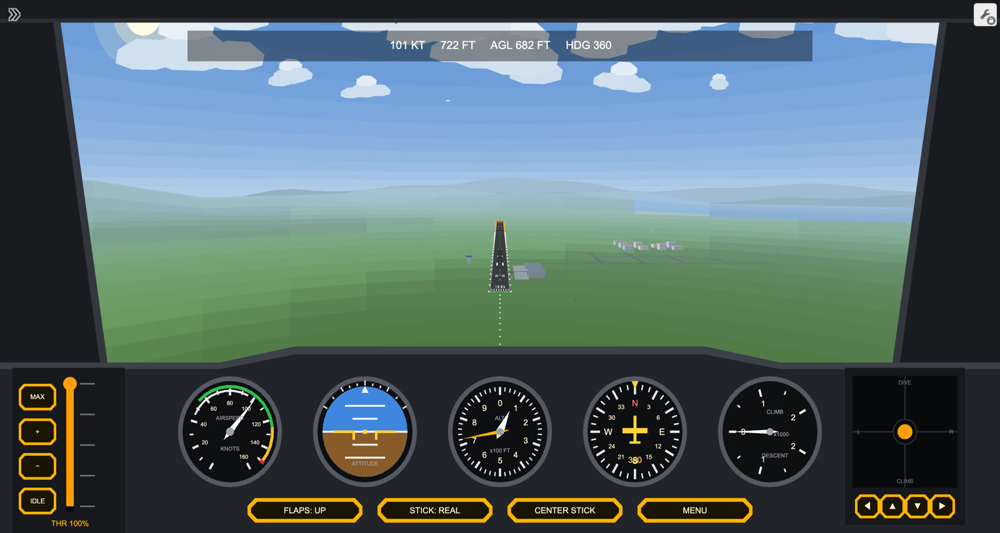
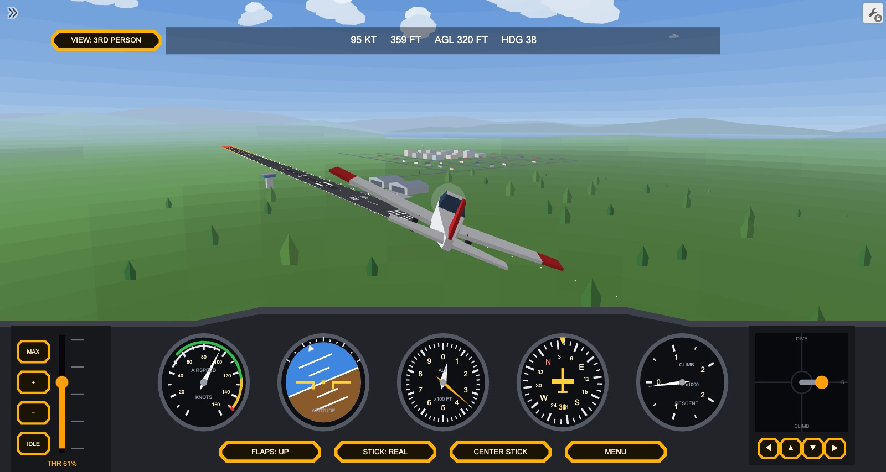
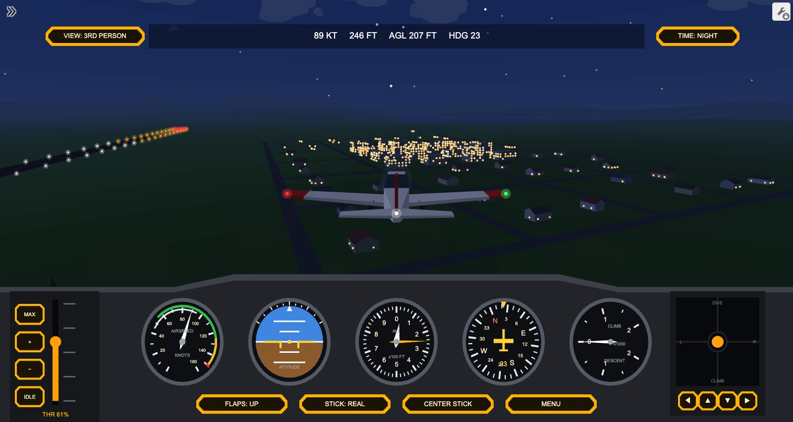
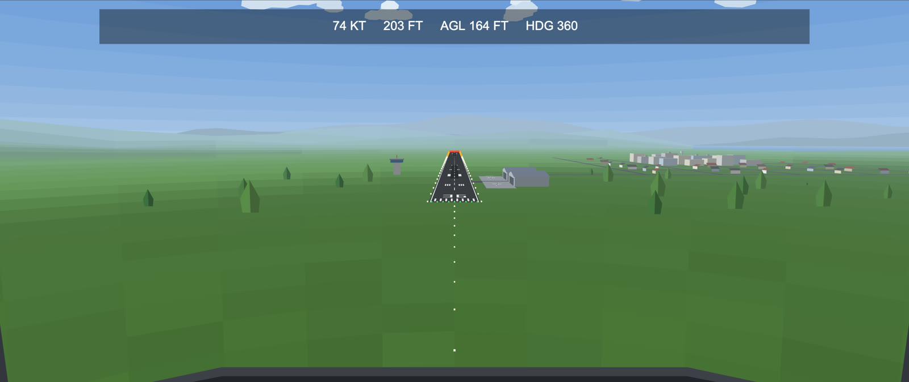
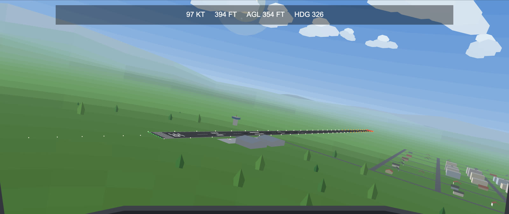

# Plane Sim: a flight simulator built inside Desmos

**[Open the live demo: desmos.com/calculator/nffcaovrtq](https://www.desmos.com/calculator/nffcaovrtq)**



Plane Sim is a flight simulator that runs entirely inside the [Desmos](https://www.desmos.com/calculator) graphing calculator. There is no game engine and no code in the page beyond Desmos expressions. The hills, lakes, sky, runway, hangars, trees, clouds and every gauge in the cockpit are drawn by math expressions that Desmos re-evaluates on every tick.

## Try it

1. Open the demo link on a laptop or desktop.
2. Close the expression list (the arrow at the top left) so the cockpit fills the screen.
3. Press **MENU**, then **TAKEOFF** to start on the runway or **FLY IN THE AIR** to start airborne.

| Control | What it does |
|---|---|
| Throttle | Drag the amber lever (bottom left) up for power, or use MAX, +, − and IDLE |
| Stick | Drag the knob in the bottom-right square: sideways to bank and turn, down to pull the nose up, up to push it down. The knob has some resistance: a ring marks where you are pulling and the stick slides there in under a second. The arrow buttons nudge it |
| FLAPS | Extra lift at low speed, for take-off and landing |
| STICK: REAL / INVERTED | Flips the stick's up and down |
| CENTER STICK | Levels everything out |
| VIEW | Top left: switches between the cockpit and a 3rd-person camera behind the plane |
| TIME | Top right: switches between day and night |

| 3rd-person view | Night over the town |
|---|---|
|  |  |

**Take-off:** full throttle, wait until the speed reads about 60 knots, then pull the stick back.

**Landing:** line up with the runway at about 70 knots with flaps down, bring the throttle low, flare gently and touch down with a sink rate under 800 ft/min, wings level, on the runway. Hills, water and hard landings are all crashes.

## What is in the world

| Feature | What is in it |
|---|---|
| Terrain | Rolling hills, valleys, lakes and coastline from a sum of sine waves, flattened around the airport. A new landscape is rolled every flight. Colored by height from water and beaches to grass, forest, rock and snow |
| Airport | An 1,800 m runway (36/18) with edge stripes, centerline, threshold bars, runway numbers, touchdown-zone and aiming-point markings, tire marks and edge lights, plus a control tower, hangars and parked planes |
| Scenery | A town next to the airport, forests scattered on a 90 m grid and cloud clusters on a 1.1 km grid |
| Sky | A 16-step gradient from horizon haze to deep blue, a sun with glare, and two ranges of distant mountains |
| Cockpit | Airspeed, attitude, altimeter, heading and vertical speed gauges, a throttle lever, a stick and a heads-up readout |
| Night | A dark sky with 240 stars and the moon, lit windows across the town, glowing runway edge, threshold and approach lights, red obstacle lights on the tower and hangars, and navigation lights and a flashing beacon on your plane |
| Your plane | In 3rd-person view: a low-wing single-engine plane with a spinning propeller, fixed landing gear and a shadow on the ground |

| Approach to runway 36 | Banking over the airport |
|---|---|
|  |  |

## How it works

**3D inside a 2D calculator.** Desmos only draws 2D shapes, so the graph does its own 3D. Every tick it builds the camera's forward, right and up vectors from the plane's heading, pitch and roll, transforms points into camera space, divides by depth and draws the result as polygons. Shapes are sorted from far to near (the painter's algorithm) so closer things cover farther ones.

**Terrain.** The ground is a fan of 561 points spread out in front of the plane: 17 directions by 33 rings, with the rings spaced geometrically so detail is dense near the plane and sparse at the horizon. The far edge moves out as the plane climbs. Each quad is colored by its height, lit from the slope of the terrain function itself (so neighboring quads blend smoothly instead of looking like a patchwork), and faded into haze with distance.

**Sky and mountains.** The sky bands and the mountain ranges are defined by direction (an angle above the horizon and a compass bearing) instead of by position, so they cost almost nothing to draw. The mountains are placed at the far edge of the terrain, so they sit on the horizon at every altitude.

**Runway markings.** Every stripe, number and marking is a rectangle on the ground that is clipped where it crosses the camera's near plane, so markings stay correct even when the plane is rolling over them. All of them live in one list, so the whole runway is drawn by a single expression.

**Trees and clouds.** Their positions come from a hash of their grid cell. The cell index is only updated by the ticker when the plane crosses into a new cell, so the hashing and the terrain height under each tree are not recomputed on every tick.

**Draggable controls.** Desmos will not let you drag a point that has a condition attached, so the stick knob and the throttle handle are plain points that fade out through an opacity expression when you are not flying. A solid copy sits underneath each one so they keep the same look as the rest of the cockpit, and a shaft drawn from the center of the stick pad to the knob shows which way the stick is pushed. The point you drag is only a target: on every tick the ticker moves the real stick toward it at a fixed speed (a full deflection takes about 0.7 seconds), so a quick flick of the mouse turns into a smooth input instead of a sudden jerk. The stick and throttle sliders have hard limits at the edges of their tracks, so dragging past an edge pins the control there. Without those limits the ticker had to pull an out-of-range value back, and Desmos skips any tick that writes to a variable you are still dragging, so the whole sim stopped until you let go.

**3rd-person view.** The VIEW button moves the camera from the cockpit to a point 17 m behind and above the plane. The camera follows the plane's heading and part of its pitch with a short lag, so you see the plane turn and pitch, but it never rolls, so the horizon stays level while the plane banks. The ticker works out a rotation matrix from the plane's body to the camera along with the plane's offset from the camera, and the 70 faces of the plane model are projected with it. Faces pointing away from the camera are skipped, the rest are sorted far to near, and each one is shaded from its angle to the sun. The shadow is the plane's outline projected along the sun direction onto the ground under the plane, and it fades out as you climb. The ground, sky and scenery were already drawn from a camera position and direction, so they only needed small changes to follow the new camera.

**Night mode.** Every color in the scene passes through three channel multipliers that are 1 by day and about 0.2, 0.25 and 0.4 at night, so one switch darkens the sky, ground, haze, clouds, buildings and mountains together and tints them blue. The lights are separate lists of points that are empty by day, and they read their own copy of the camera that the ticker only updates at night, so by day Desmos never recomputes them and night mode costs nothing until it gets dark. The build script places about 1,000 window lights on the walls of the town's buildings, and only windows on walls facing the camera are drawn. Windows that fall inside the on-screen outline of a hangar and are farther away than it are hidden, so the town does not shine through the hangars.

**Flight model.** Speed comes from thrust (weaker at altitude), drag and gravity along the pitch angle. The plane sinks below its stall speed, flaps lower that stall speed, and banking turns the plane at the rate a real coordinated turn would (9.81·tan(bank)/speed). On the ground the plane rolls on the runway; touching down checks the sink rate, bank, pitch, speed and whether you are over the runway, land or water.

## Keeping it fast

Desmos recomputes every expression that depends on something that changed, and each of those expressions has a fixed cost on top of its math. Most of the speed work is about keeping that count down:

- Helper expressions that are only used once are folded into the expression that uses them.
- The runway, the sky and the mountains are each a single list expression instead of one expression per piece, and the cockpit's 125 fixed shapes are drawn by a handful of list expressions.
- Values that change only when the plane crosses a grid cell are written by the ticker only when they actually change.

## Fixing the freezes

The graph used to slow down and then freeze for several seconds at a time after a minute or two of flying, especially while turning with the arrow buttons. The cause was inside Desmos: it turns list math into JavaScript functions, and when a number used in that math is a long decimal (like the sine of the heading), it writes that number straight into the function's code. Since the heading, position and camera angles change on every tick, Desmos was generating thousands of brand-new functions per second, its background worker's memory grew past a gigabyte, and the freezes were the browser cleaning that up.

The fix keeps every per-tick number short. The ticker rounds the plane's position and angles to six decimal places, computes the camera's sines, cosines and direction vectors itself (also rounded), and the graph avoids feeding values like π or square roots of moving numbers into list math. Desmos treats short decimals as exact values it can pass in instead of rewriting code, so the same compiled functions are reused every tick and memory stays flat. Rounding to a micrometer and a microradian is invisible on screen. A smaller leak remained while pitching: the sky bands multiply the sine of each band's fixed angle by the camera pitch, and Desmos baked those products into code too. Rounding the fixed sines makes the products exact, so the leak is gone.

## Repository layout

```
graph/
  plane-sim.json      the full graph state
  plane-sim-v1.json   the graph before the graphics and speed pass
tools/
  plane.mjs           builds plane-sim.json from plane-sim-v1.json: sky gradient, mountains,
                      smooth terrain lighting, haze, runway markings, per-cell scenery caching,
                      expression folding, merged cockpit shapes, rounded ticker values
  chase.mjs           adds the 3rd-person view: camera, plane model, shadow and VIEW button
  night.mjs           adds night mode: darkened colors, stars, moon, lights and TIME button
  lib.mjs             helpers for editing graph states and folding single-use expressions
  check.mjs           loads graph states in Chrome and lists any expression errors
  bench.mjs           measures ticks per second for several graph states, interleaved
  shot.mjs            takes screenshots of a graph state from chosen positions
docs/images/          screenshots used above
```

To rebuild the graph (the output is identical every time) and check it:

```
npm install
node tools/plane.mjs graph/plane-sim-v1.json graph/plane-sim.json
node tools/check.mjs graph/plane-sim.json
```

The tools drive Google Chrome through Playwright, so Chrome needs to be installed.

## Credits

Built on the [Desmos Graphing Calculator](https://www.desmos.com/calculator). This project is not affiliated with Desmos.

## License

MIT License (see `LICENSE`).

Built by Kenneth Shi.
